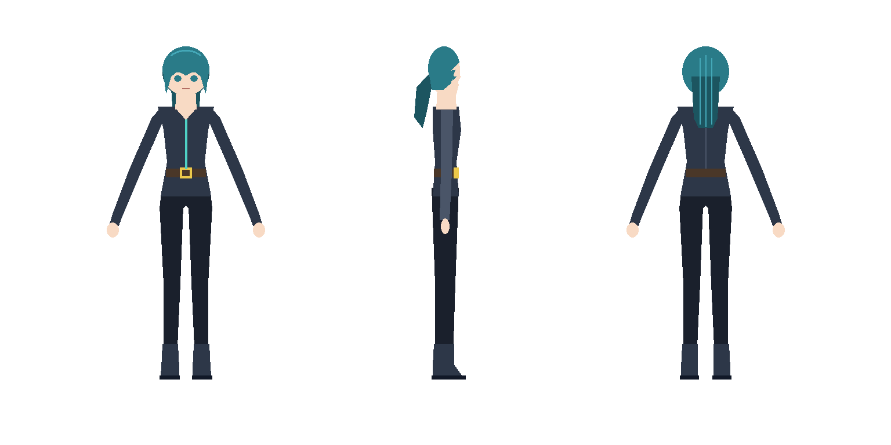
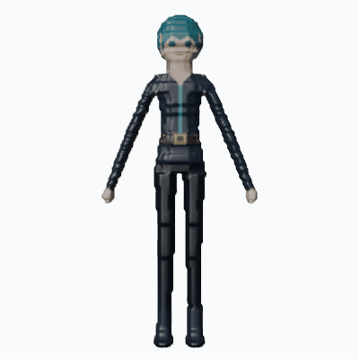
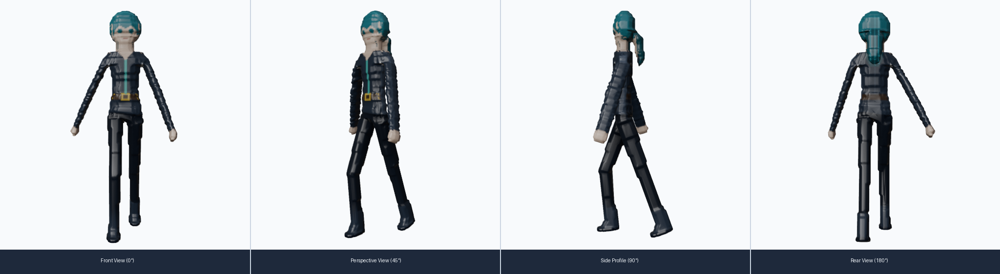

# Pygmalion MCP *(CharForge Engine)*

MCP server cho coding agent: lấy cảm hứng từ điêu khắc gia **Pygmalion** trong thần thoại Hy Lạp, biến **character turnaround sheet** 2D (front/side/back) thành **model 3D gắn xương và hoạt hóa hoàn chỉnh** theo quy trình **tự động 100%**. Agent tự sinh mesh, render lại đúng 3 góc bằng Blender headless, chấm điểm silhouette bằng số so với ảnh gốc, tự biến dạng khớp tỷ lệ, tối ưu lưới, xuất GLB/FBX, gắn xương Mixamo và sinh animation clips. Model điều phối có thể là loại nhanh/rẻ (cỡ Flash), vì mọi quyết định khó nằm trong code: `next_action`, ngưỡng điểm, ngân sách vòng lặp.

---

## Kết quả Mẫu Tự Hành (Autonomous Pipeline Showcase)

Toàn bộ quy trình từ ảnh turnaround 2D phẳng đến model 3D rigged & animated được điều phối tự hành qua `pipeline_run(project_id="aria", rig=True, animate=True)`:

### 1. Đầu vào 2D Turnaround Sheet (`assets/aria_turnaround.png`)

*Hình 1: Bản vẽ turnaround sheet 2D 1536×768 px của nhân vật "Aria" gồm 3 góc nhìn Front, Side (facing right) và Back ở tư thế A-pose chuẩn giải phẫu, nền trắng tuyệt đối, đạt điểm tách `sheet_split` confidence 1.0.*

### 2. Model 3D Đã Gắn Xương & Chuyển Động (`assets/aria_preview.gif`)

*Hình 2: Turntable 360° kết hợp chu kỳ bước chân (walk cycle animation) render trực tiếp từ `projects/aria/export/aria-animated.glb` bằng Blender Workbench headless.*

### 3. Ảnh Render Đa Góc Nhìn (`assets/aria_render.png`)

*Hình 3: Kết quả render 4 góc nhìn chuẩn mực (Front 0°, Perspective 45°, Side 90°, Rear 180°) từ model 3D `aria.glb` với đầy đủ màu sắc đỉnh (vertex colors) từ visual-hull blockout.*

---

## Tính Năng & Cấp Độ

| Level | Gồm | Trạng thái |
|---|---|---|
| **L1 – Mắt** | `project_create`, `project_status`, `sheet_split`, `render_views`, `score_mesh` | Đã hoàn thành & kiểm thử 100% (Blender headless + OpenCV/NumPy) |
| **L2 – Tay** | `generate_mesh` (Tripo/Meshy/Rodin/Hunyuan hoặc visual-hull `blockout`), `mesh_fit`, `mesh_optimize`, `mesh_export` | Đã hoàn thành & kiểm thử 100% (Lattice fitting, decimate, bounding box safety) |
| **L3 – Hoàn thiện** | `auto_rig` (rig + kiểm tra biến dạng + tự sửa trọng số), `animate` (preset/Text to Motion/procedural + chuyển động phụ + preview), `pipeline_run` (tự hành toàn trình) | Đã hoàn thành & kiểm thử (rig QA, multi-clip GLB, spring bones) |

---

## Chi Tiết Công Cụ Level 3

### `auto_rig(project_id, mesh_path=None, method="auto")`
- **Rig**: ưu tiên Meshy Rigging API (`POST /openapi/v1/rigging`) khi có `MESHY_API_KEY` và mesh gốc từ Meshy; không có thì rig offline trong Blender (22 xương Mixamo, khớp xác định bằng medial-axis, hành lang chi chống rò trọng số).
- **Kiểm tra biến dạng cho mọi rig (`pose_deformation_check`)**:
  * Nhận diện vai trò xương từ cấu trúc cây xương và vị trí khớp, không tin tên: chạy với tên Mixamo, UE (`upperarm_l`) hay tên vô nghĩa.
  * Vung từng cánh tay 40° (ra trước, giơ ngang) và từng đùi 40° (ra trước), đo xem đùi, thân, đầu và chi còn lại có bị kéo theo không. Vùng cơ thể của đỉnh lấy theo khoảng cách tới đoạn xương, không dùng trọng số đang bị kiểm tra.
  * Đo tiếp xúc: cẳng tay/bàn tay dính thân hay đùi, hai ống chân dính nhau (váy nối hai chân không bị tính nhầm).
  * Rig Meshy rớt kiểm tra → **tự sửa trọng số** (tay không kéo chân/thân/váy, chân không kéo tay…), kiểm tra lại, chỉ giữ khi tốt hơn. Rig gốc của Meshy được giữ ở `meshes/<id>-rigged-provider.glb`.
- **Bản đồ humanoid** `export/<id>-humanoid.json`: vai trò → tên xương + tên Mixamo tương ứng, để retarget sang Unity/UE/Blender.
- Kết quả: `export/<id>-rigged.glb`, `data.rig_check` (passed, repaired, issues, từng phép thử), báo cáo đầy đủ `renders/qa/rig_check.json` · `next_action`: `animate`.

### `animate(project_id, mesh_path=None, actions=None, motions=None, method="auto", secondary="auto")`
- **Provider (Meshy)**: preset từ thư viện animation (`POST /openapi/v1/animations` với `action_ids`, 1 file nhiều clip); **Text to Motion** cho động tác riêng: `motions=[{"prompt": "xoay một vòng rồi cúi chào", "name": "bow", "duration": 4}]` → `POST /openapi/v1/text-to-motion` → `POST /openapi/v1/animations {motion_task_id}`; tất cả ghép vào một GLB. Rig đã được sửa trọng số thì trọng số đã sửa được chép sang file animation (Meshy hoạt hình hóa bản rig chưa sửa của họ).
- **Blender procedural (offline)**: chạy trên mọi rig humanoid (tìm xương theo vai trò, xoay quanh trục giải phẫu): `idle` (thở, dồn trọng tâm), `walk`/`run` (hông nhún–lệch–xoay, gối gập pha vung, tay hạ từ A-pose và vung ngược pha), `wave`, `jump`.
- **Chuyển động phụ** (`secondary="auto"`): tự phát hiện đuôi tóc/tóc dài và váy, thêm chuỗi xương lò xo, mô phỏng quán tính + va chạm với chân/thân rồi bake vào từng clip; chỉ giữ khi bề mặt không bị giãn thêm.
- **Duyệt bằng mắt + chấm điểm**: mỗi clip render 6 frame từ front và side → `renders/anim/<clip>.png`; đo độ giãn bề mặt (`stretch_p99`) và độ xuyên sàn (`ground_cm`) → `data.motion_check`.
- Kết quả: `export/<id>-animated.glb` chứa đủ các clip, tên clip được kiểm tra trực tiếp trong chunk JSON của GLB.

### `pipeline_run(project_id, max_seconds=240, rig=True, animate=False)`
- Tự động thực thi toàn bộ chuỗi công cụ theo máy trạng thái từ đầu vào sheet ảnh 2D đến thành phẩm cuối cùng mà không cần can thiệp thủ công:
  `project_create → sheet_split → generate_mesh → score_mesh ⇄ mesh_fit → mesh_optimize → mesh_export → auto_rig → animate`.
- Job cloud đang chạy được poll lại mỗi 5 s (tránh bị giới hạn tốc độ); cảnh báo QA của từng bước được gom vào kết quả.

### Kiểm toàn vẹn mesh và critic thị giác độc lập (`score_mesh`, `animate`)
- **Toàn vẹn hình học** (luôn chạy, chỉ bằng số): đếm mảnh vụn, phần bị tách khỏi thân, lỗ hở, cạnh non-manifold và bề mặt tự cắt. Mesh có phần bị tách hoặc tự cắt nhiều sẽ xếp sau mesh lành trong số các mesh đã passed.
- **Critic thị giác** (tùy chọn): một model thị giác (mặc định Gemini 4 Argon, hoặc Claude) so ảnh sheet với ảnh render màu theo rubric cố định gồm mặt, texture, chi tiết, giải phẫu và lỗi hình học, rồi chấm điểm 0–10 kèm lỗi cụ thể. Với animation, critic soi contact sheet từng clip để tìm tư thế gượng, xuyên vật thể và biến dạng.
  - Model điều phối không bao giờ tự chấm sản phẩm của mình.
  - Critic chỉ tư vấn: không đổi `passed`, chỉ chọn giữa hai mesh đã passed khi chênh từ 1 điểm trở lên, và đưa ra cảnh báo.
  - Dùng Gemini (mặc định): `pip install -e ".[critic]"` rồi đặt `GEMINI_API_KEY`. Dùng Claude: `pip install -e ".[critic-claude]"` rồi đặt `ANTHROPIC_API_KEY`.
  - `CHARFORGE_CRITIC=auto|on|off` để bật/tắt, `CHARFORGE_CRITIC_BACKEND=auto|gemini|claude` để chọn model (auto ưu tiên Gemini khi có key). Model mặc định là `gemini-4-argon` và `claude-opus-5-5` (đổi trong `CRITIC.models` ở `config.py`). Tối đa 6 lượt gọi mỗi project. `python -m charforge --check` cho biết critic đang dùng model nào, hoặc còn thiếu gì.
  - Nếu model điều phối cũng là Gemini (ví dụ Antigravity), có thể đặt `CHARFORGE_CRITIC_BACKEND=claude` để critic đến từ một họ model khác.
  - Khi bật, ảnh sheet và ảnh render được gửi tới Gemini API hoặc Claude API. Gemini được gọi với `store=false`, nên interaction không được lưu lại để truy xuất sau.

### Khe hở tư thế (A-pose) quan trọng ngang code
`sheet_split` và `score_mesh` đo khe hở giữa cẳng tay/bàn tay với thân và giữa hai ống chân trên silhouette front. Tay sát thân hoặc hai đùi dính nhau là nguyên nhân chính khiến trọng số rò ("dính" khi chạy animation). Sheet dính → cảnh báo sớm. Sheet tách rời mà mesh Meshy lại dính → pipeline sinh thêm một ứng viên và ưu tiên mesh không dính.

### Giới hạn còn lại
- Chuyển động phụ là spring bone đã bake, không phải mô phỏng vải: không có nếp gấp, va chạm xấp xỉ.
- Không có rig mặt/blendshape (mắt, miệng thường chỉ là texture), nên chưa có biểu cảm hay nhép miệng.
- Hình học tay/đùi đã dính trên mesh thì QA chỉ phát hiện và giảm rò, không tách được.
- Animation gắn với khung xương của rig; dùng `humanoid.json` để retarget (rig nghỉ ở A-pose).

---

## Cài đặt & Kiểm Tra

Yêu cầu Python 3.11+ và Blender 4.2+ (hỗ trợ Windows, Linux, macOS).
```bash
# Cài đặt môi trường
python -m venv .venv
source .venv/bin/activate  # Trên Windows: .venv\Scripts\activate
pip install -e ".[dev]"

# Tạo cấu hình môi trường
cp .env.example .env

# Kiểm tra môi trường và đường dẫn Blender
python -m charforge --check
```

Trong `.env`: cấu hình `CHARFORGE_LEVEL=3` để kích hoạt đầy đủ Level 1, 2 và 3. Khi không có cloud API keys, pipeline tự động sử dụng visual hull blockout và Blender procedural animation ngoại tuyến.

### Chạy Test Suite
```bash
# Kiểm tra bộ test hợp đồng và pipeline e2e
pytest tests/test_animate.py tests/contract/ tests/test_providers.py tests/e2e/test_pipeline_e2e.py -q
# QA rig/animation trên nhân vật tổng hợp (cần Blender)
pytest tests/test_rig_qa.py tests/test_anim_qa.py tests/test_pose_gaps.py -q
```

---

## Gắn MCP Vào Coding Agent

Server chạy qua giao thức stdio tiêu chuẩn: `python -m charforge`.
- **Claude Code**: Đã có cấu hình trong `.mcp.json`. Mở Claude Code tại thư mục này và cấp quyền chạy server `charforge`.
- **Gemini CLI**: Cấu hình trong `.gemini/settings.json`.
- **Antigravity / Cursor / Cline / Roo Code**: Thêm khối sau vào file cấu hình MCP của client:
```json
{
  "mcpServers": {
    "charforge": {
      "command": "python",
      "args": ["-m", "charforge"]
    }
  }
}
```

---

## Hướng Dẫn Sử Dụng Nhanh

Giao cho agent lời nhắc (prompt):
> Dùng CharForge dựng model 3D từ `assets/aria_turnaround.png`, tên `aria`, cao 165 cm. Chạy `pipeline_run(project_id='aria', rig=True, animate=True)` cho tới khi `next_action` là null, rồi báo các file output và animation tracks đã tạo.

Kết quả sẽ được ghi đầy đủ vào `projects/<id>/`:
- `views/reference.json`: Dữ liệu phân tích góc nhìn, thông số tỷ lệ và khe hở tư thế
- `export/<id>.glb`: Model 3D tối ưu hóa lưới
- `export/<id>-rigged.glb`: Model đã gắn xương (đã qua kiểm tra biến dạng, sửa trọng số nếu cần)
- `export/<id>-humanoid.json`: Bản đồ xương để retarget
- `export/<id>-animated.glb`: Model tích hợp sẵn các action tracks (`idle`, `walk`, `wave`, clip Text to Motion, chuỗi tóc/váy)
- `renders/anim/<clip>.png`: Ảnh duyệt từng clip (front + side), `renders/qa/rig_check.json`: báo cáo kiểm tra rig

---

## Tài Liệu Kỹ Thuật

- [ARCHITECTURE](docs/ARCHITECTURE.md): Kiến trúc hệ thống, máy trạng thái và công thức tính điểm silhouette
- [TOOLS](docs/TOOLS.md): Quy cách chi tiết (contracts, parameters, return envelopes, error codes) của toàn bộ 12 MCP tools
- [ROADMAP](docs/ROADMAP.md): Lịch trình phát triển và kiểm thử qua các milestone
